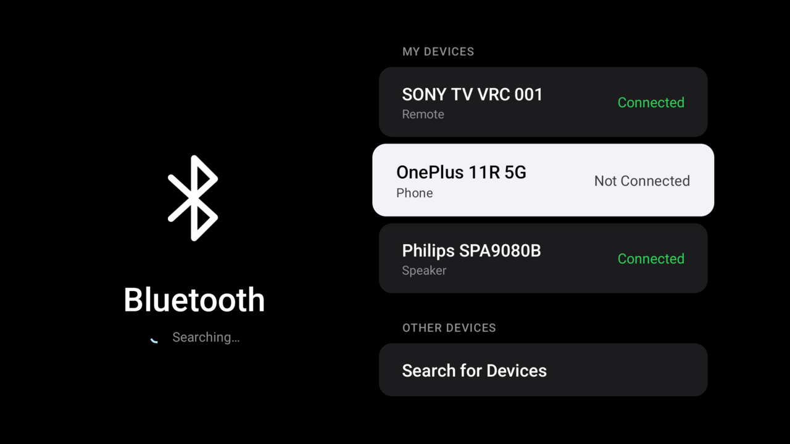
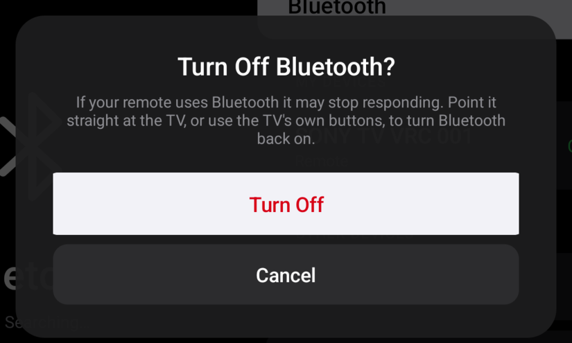

# TV Bluetooth

A clean, minimal Bluetooth manager for Android TV and Google TV, designed for the remote.

The built-in **Pair accessory** screen on many Android TVs only lists the devices it thinks are
remotes or headphones, and keeps showing *Searching for accessories…* for everything else. Plenty of
speakers, soundbars and headsets announce themselves as a "hands-free" or generic device and never
appear there, even though the TV can see them. TV Bluetooth lists every nearby device and pairs it
directly.

<p align="center">
  
</p>

## Features

- **Every nearby device**, with the name it advertises, over both classic Bluetooth and Bluetooth LE.
  Devices that never send a name are tucked behind *Show Unnamed Devices*.
- **Pair anything**: speakers, soundbars, headphones, remotes, keyboards, mice, game controllers.
- **Right profile, automatically**: audio devices connect over A2DP (plus headset where supported),
  input devices over HID. The profile is chosen from what the device itself reports.
- **My Devices** shows paired devices with their live state. Select one for **Connect** or
  **Disconnect**, **Forget This Device**, or **Cancel**.
- **Bluetooth On / Off** at the top, with a safe **Restart Bluetooth** that turns it back on by itself.
  Turning it off or forgetting a remote always asks first.
- Looks at home on a TV: black background, large type, one focused card at a time, like tvOS Settings.
- Tiny (about 30 KB), no internet permission, no analytics, no ads.

<p align="center">
  
</p>

## Install

1. Download `tv-bluetooth.apk` from the [latest release](../../releases/latest).
2. Install it on the TV, with any of these:
   - **ADB** over the network: `adb connect <tv-ip>` then `adb install tv-bluetooth.apk`
   - the **Downloader** app or a file manager, after allowing *Install unknown apps* for it
3. Open **Bluetooth** from the app row on the home screen.

The first time it opens, it asks for the Bluetooth permission (*Nearby devices* on Android 12 and
newer, *Location* on Android 6 to 11, where Android requires it for Bluetooth scanning).

## Use

| On | Press OK to |
|---|---|
| **Bluetooth** row | Restart Bluetooth, turn it off, or turn it on |
| A device under **Other Devices** | Pair it and connect it |
| A device under **My Devices** | Connect / Disconnect, Forget This Device |
| **Search for Devices** | Search again (the Menu key does the same) |

Put your speaker or headphones in pairing mode before searching. Once a speaker is paired, turning it
off and on again makes it reconnect to the TV by itself.

## Compatibility

Runs on Android TV and Google TV devices from Android 5.0 (API 21) onwards: TVs, set-top boxes and
streaming sticks. Searching and pairing use standard Android Bluetooth APIs.

| Feature | Android 5 – 12 | Android 13 + |
|---|---|---|
| Find, name and pair devices | Yes | Yes |
| Connect, disconnect, forget | Yes, unless the firmware blocks it | Yes, unless the firmware blocks it |
| Turn Bluetooth on | Yes | Yes (Android asks to confirm) |
| Turn Bluetooth off / restart | Yes | Opens the TV's Bluetooth settings: Android 13 no longer lets apps turn Bluetooth off |

Connect, disconnect and forget go through Bluetooth functions some manufacturers lock down. Where a
TV refuses, the app says so and pairing still works; most speakers then connect on their own.

On Android 6 to 11, keep the TV's Location setting on while searching, or Android returns no results.

## Build

No Gradle needed. With JDK 11+ and the Android SDK (platform 34 and any recent build-tools):

```sh
./build.sh
```

`build.sh` reads `ANDROID_HOME` and `JAVA_HOME`, compiles with `aapt2`, `javac` and `d8`, and signs
`tv-bluetooth.apk` with `keystore.jks`, creating one the first time. Point `KEYSTORE`,
`KEYSTORE_PASS` and `KEY_ALIAS` at your own key to sign with it.

Every push is built by GitHub Actions; tags named `v*` publish the APK as a release.

## License

TV Bluetooth is dual-licensed.

- **Open source: [GPL-3.0](LICENSE).** Use, modify and share it freely, as long as anything you build on
  it is released under the GPL too, with its source and this copyright notice.
- **Commercial license.** To ship TV Bluetooth, or code from it, in a closed-source or proprietary
  product, you need a commercial license. Write to v8v88v8v88@protonmail.com.

Copyright © 2026 Vaibhav Pratap Singh (V8V88V8V88).
